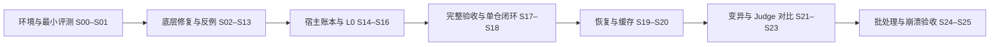

# Godot 迁移 Agent：从这里逐项开发

**当前入口**：按下面 S00→S25 的顺序推进；每一步都同时包含修复/开发和验收，不再按“基础设施全部完成→编排→最后补 eval”推进。

配套：[问题总账与复现](DEFECTS.md) · [历史核查证据](LANDMARKS_REVIEW.md)。

更新：2026-10-17；现状基准 `701315b05fdd433d5b6eb0d112a8d406203c8245`。本轮只修订规划文档，没有实现下面的功能；清单保持未完成。

## 先读这几条

- 已有 read/grep、受控编辑、代码/场景索引、Godot 验证栈和 RAG 主体；migration_agent 四个子包目前是骨架。
- 第一版聚焦单机：独立工作区、Python 进程内组合、SQLite 和后续进程池。保留 CLI/MCP 对外入口，不引入当前不需要的 FastAPI/Redis。
- 代码说明“现在有什么”，本套 LANDMARKS 说明“接下来做什么”；旧 NEXT_STEP/AGENTS 中的历史任务顺序已在入口说明中解除，不据此绕过仍有效的语言、路径、依赖和受控写入规则。
- 同一时间只推进当前步骤；先写真实反例，修复后再通过相应验收。每项记录测试命令、版本和结果，不能只看返回 ok。
- eval 分四次进入：S01 固定样本/独立验证器，后续每次修复加单测，S17/S18 验证系统闭环，S21/S22/S23 扩展变异/Judge/对比评测。

配套交付：[简历条目与 STAR 面试话术](RESUME_ENTRY.md)，含已核算的 RAG 指标、假设完成范围和后续补数位置。

## 观测与评测：从首个模型调用就接入

**统一路径**：OpenTelemetry SDK → OTLP HTTP → Collector → Langfuse / Phoenix。Langfuse 负责模型调用、成本与实验追踪；Phoenix 侧重检索、工具和失败诊断。二者共用调用链和同一份独立评分；SQLite 保存完整恢复/成本账本，后端不能替代本地事务。

按顺序执行：**S01** 固定 span/评分契约，**S13** 补检索缓存事件，**S14** 接通 OTel 与真实双后端，**S18** 验收失败调用链，**S19** 关联恢复前后 trace，**S21–S23** 接入数据集/实验/评分并做消融，**S24–S25** 验收跨进程和崩溃。OTLP 传 trace，评分用显式 SDK/API 幂等上传，不让两个平台各跑一次 Judge。

展开看 [OTel 实现与验收契约](migration_agent/trace/LANDMARKS.md)；对应问题 [TRC-05](migration_agent/trace/DEFECTS.md)、[TRC-06](migration_agent/trace/DEFECTS.md)、[EVAL-04](migration_agent/eval/DEFECTS.md)。当前均为待实现规划，尚无平台联调或效果数字。

## 故障恢复的唯一方案

采用 **LangGraph 原生持久化 checkpoint + 外部副作用对账**。S18 接 SqliteSaver、thread_id=run_id 和同步落盘；S19 核对 Git/业务 SQLite/索引后续跑；S24/S25 由父进程清理和重排 worker。图的执行位置与状态由框架恢复，补丁/回滚/成本由外部账本核验，OTel 只做观测。不能把两类 SQLite 表当一套原子事务，也不能声称 checkpoint 会自动回滚代码或使模型调用恰好一次。

实现细节见 [恢复契约](migration_agent/orchestrator/LANDMARKS.md)，架构决定见 [ADR-0001](docs/adr/0001-langgraph-checkpoints-and-external-effects.md)。当前控制流、checkpointer 与完整恢复尚未实现，完成后再使用简历中的完成措辞。

## 文中几个常用词

- **run**：某仓库在某一组配置下的一次完整迁移；重复评测是新 run，resume 继续原 run。
- **round / attempt**：round 是一次全库观察与候选修复循环；attempt 是一次编辑尝试，拒绝也记录。
- **Gate**：根据验证结果决定继续/停止的确定性代码；不负责替模型选择所有修法。
- **哨兵与覆盖**：哨兵是自动生成的检测脚本；覆盖说明实际检查了哪些文件，没报错不一定代表全查完。



## 下级导航

- [原生工具](inline_tools/LANDMARKS.md)
- [索引与验证底座](codebase_index/LANDMARKS.md)
- [迁移知识库](rag/LANDMARKS.md)
- [宿主与命令行](migration_agent/LANDMARKS.md)

## 完整执行队列

下面包括所有已发现修复和后续新增功能。根目录是跨模块顺序的唯一清单；子目录保留同一个步骤号。**“完成”须满足本步验收，不能仅因某份旧计划已打勾而跳过。**

<a id="s00"></a>

### S00：固定环境、真实接口与观测配置

- [x] **实现/修复**：固定 Python/依赖、目标 Godot、规则/语料指纹与 OTel 语义约定版本。检查 OTLP HTTP、Collector 和 Langfuse/Phoenix endpoint 的配置格式；凭据只引用环境变量。先补真实 API 契约，不接模型。
- [x] **交付**：交付环境与接口检查；记录四组测试结果。观测 profile 区分 offline/双后端，缺引擎或缺后端部署均写待验收，不伪造可用。
- [x] **测试门**：异 CWD 冒烟；未知键、缺引擎、错误协议/endpoint 明确失败；离线单测不要求后端在线。

**展开指导**：[宿主与命令行](migration_agent/LANDMARKS.md)。

**对应问题**：[DOC-01 · 旧规划把不存在的接口当作可复用能力](DEFECTS.md)。

<a id="s01"></a>

### S01：先建最小独立评测器与观测契约测试

- [ ] **实现/修复**：先定义固定 case、隐藏真值、结果分类与独立验证器；同时写 OTel span/评分字段契约和内存 exporter 反例。六类项目先用 fake verifier，再补锁定引擎集成验证。
- [ ] **交付**：交付正确/错误/等价替代对照，隐藏答案位于 Agent 工作区外。定义 case_id→run_id→trace/span 的关联及评分明细格式，OTel 正式接线在 S14。
- [ ] **测试门**：错误不通过、缺证据标 INVALID/INCOMPLETE；read/grep 不读真值；fake 调用树与评分重复提交测试先固定预期。

**展开指导**：[独立评测与批处理](migration_agent/eval/LANDMARKS.md)、[轨迹、预算与恢复](migration_agent/trace/LANDMARKS.md)。

**对应问题**：[EVAL-01 · 参考答案放进项目副本会泄漏给 Agent](migration_agent/eval/DEFECTS.md)。

<a id="s02"></a>

### S02：修中文索引与配置路径

- [ ] **实现/修复**：先修 UTF-8 span，再统一规则库配置相对路径。这两项会影响后面的符号守卫、场景规则和跨目录调用。
- [ ] **交付**：交付 parser 切片修复和确定的路径规则；改动目录 README 同步。
- [ ] **测试门**：中文注释/字符串/标识符正确；同配置不同 CWD 得到同规则库。

**展开指导**：[索引与验证底座](codebase_index/LANDMARKS.md)、[符号与依赖索引](codebase_index/index/LANDMARKS.md)。

**对应问题**：[IDX-01 · 中文让符号名和调用关系切片错位](codebase_index/index/DEFECTS.md)；[CFG-01 · 规则库相对路径跟着启动目录漂移](codebase_index/DEFECTS.md)。

<a id="s03"></a>

### S03：补依赖提取，再做根因排序

- [ ] **实现/修复**：提取顶层/函数体 preload 与路径/类名 extends 的文件依赖。新增 rank_root_cause_files，返回排序及无法解析的证据；不查询不存在的 relations 表。
- [ ] **交付**：交付依赖查询 API；循环先聚成组，再按被依赖关系排序；同分时使用稳定路径排序。
- [ ] **测试门**：链式、经无报错中间节点、循环、未知目标和中文脚本均有反例；根因优先，未知不伪装已解析。

**展开指导**：[符号与依赖索引](codebase_index/index/LANDMARKS.md)。

**对应问题**：[IDX-02 · 现有依赖边不足以排序根因脚本](codebase_index/index/DEFECTS.md)。

<a id="s04"></a>

### S04：修真实规则库接入和场景增量对比

- [ ] **实现/修复**：用真实 migration_rules 库打通旧类型检查，再限制增量 fixed 的计算范围。
- [ ] **交付**：交付规则库兼容读取和实际已检查范围传递；保留规则不可用的覆盖标记。
- [ ] **测试门**：旧引擎类型可检出；只查 a 不会宣称 b 已修；合法新类型不被误报。

**展开指导**：[场景检查与基线](codebase_index/index/src/codeindex/scene/LANDMARKS.md)。

**对应问题**：[SCN-01 · 真实规则库查错表，旧类型检查被静默跳过](codebase_index/index/src/codeindex/scene/DEFECTS.md)；[SCN-02 · 只检查一个场景，却宣布其他场景已修复](codebase_index/index/src/codeindex/scene/DEFECTS.md)。

<a id="s05"></a>

### S05：修场景回调归属并接通一次性冻结

- [ ] **实现/修复**：先修同名回调跨脚本误报和多引用漏报，再实现 run_scene_freeze/scene-freeze；冻结要保存独立标记及 L0 commit。
- [ ] **交付**：交付单事务冻结与重复冻结拒绝。空问题基线也有标记，恢复不重新冻结。
- [ ] **测试门**：根/子节点、跨脚本同名、多个场景；重复与中断冻结不洗掉原有证据。

**展开指导**：[符号与依赖索引](codebase_index/index/LANDMARKS.md)、[场景检查与基线](codebase_index/index/src/codeindex/scene/LANDMARKS.md)。

**对应问题**：[SCN-03 · 同名回调跨脚本误报，并且只报第一个引用](codebase_index/index/src/codeindex/scene/DEFECTS.md)；[SCN-04 · 基线有底层函数，却没有安全的生产冻结入口](codebase_index/index/src/codeindex/scene/DEFECTS.md)。

<a id="s06"></a>

### S06：接通改名守卫和公开编辑入口

- [ ] **实现/修复**：公开导出 edit；检测声明改名并查询场景引用；索引空/坏/过期时可靠回退 grep。
- [ ] **交付**：交付可调用包入口和 INCONSISTENT_RENAME 警告；不任意配对多改名，不将警告误变成硬拒绝。
- [ ] **测试门**：实际 edit 到 commit 的测试覆盖单/多改名、纯删除及索引回退。

**展开指导**：[受控编辑与守卫](inline_tools/editandfixguard/LANDMARKS.md)。

**对应问题**：[EDT-01 · 包入口没有导出约定的 edit API](inline_tools/editandfixguard/DEFECTS.md)；[EDT-02 · 函数改名后场景仍用旧名，编辑流水线没有提醒](inline_tools/editandfixguard/DEFECTS.md)；[EDT-03 · 索引文件存在就关闭 grep 回退，导致漏报](inline_tools/editandfixguard/DEFECTS.md)。

<a id="s07"></a>

### S07：统一 create 与场景写后验收

- [ ] **实现/修复**：新脚本显式验语法；场景写前和写后都只拒绝新增回归。
- [ ] **交付**：交付失败不改变字节/HEAD、合法改动只产生目标提交的编辑事务。
- [ ] **测试门**：新建坏脚本失败；存量坏场景的无回归改动成功；新增场景错误回滚。

**展开指导**：[受控编辑与守卫](inline_tools/editandfixguard/LANDMARKS.md)。

**对应问题**：[EDT-04 · 写后复核把存量场景错误当作新回归](inline_tools/editandfixguard/DEFECTS.md)；[EDT-05 · create 绕过语法和反向迁移检查](inline_tools/editandfixguard/DEFECTS.md)。

<a id="s08"></a>

### S08：补所有文本后缀守卫与适用范围

- [ ] **实现/修复**：分清声明消失与旧 API 使用；按 owner/版本判断，覆盖场景/shader/配置通用风险；同时清理临时补丁泄漏。
- [ ] **交付**：交付保守的符号适用检查、逐后缀守卫矩阵和完整临时文件清理。
- [ ] **测试门**：同名自定义函数不误拒，真旧 API 有证据；成功/失败/超时均无临时补丁遗留。

**展开指导**：[受控编辑与守卫](inline_tools/editandfixguard/LANDMARKS.md)。

**对应问题**：[EDT-06 · 非脚本文件缺通用守卫，场景删除也未覆盖](inline_tools/editandfixguard/DEFECTS.md)；[EDT-07 · G5.1 只看声明名字，既漏旧 API 又误杀用户函数](inline_tools/editandfixguard/DEFECTS.md)；[EDT-08 · git apply 临时补丁文件未清理](inline_tools/editandfixguard/DEFECTS.md)。

<a id="s09"></a>

### S09：隔离局部检查、修熔断和阈值接线

- [ ] **实现/修复**：局部检查不进入全库历史；OPEN 在启动 Godot 前短路；入口注入实际 RetryGateConfig。
- [ ] **交付**：交付稳定的 VerifyGateResult；继续使用真实 decision 枚举，明确重置策略。
- [ ] **测试门**：全库 A→局部空→全库 A 不假震荡；真全库循环会停；OPEN 后 spawn=0；自定义阈值生效。

**展开指导**：[Godot 验证栈](codebase_index/godot_mcp/LANDMARKS.md)。

**对应问题**：[VER-01 · 局部检查污染全库历史，造成假震荡](codebase_index/godot_mcp/DEFECTS.md)；[VER-02 · 熔断已 OPEN，下一次健康输出又允许继续](codebase_index/godot_mcp/DEFECTS.md)；[VER-03 · retry_gate YAML 没接到默认工具入口](codebase_index/godot_mcp/DEFECTS.md)。

<a id="s10"></a>

### S10：补验证快照与重导触发范围

- [ ] **实现/修复**：快照包含实际编辑后缀；识别内嵌 shader/项目配置、class_name 与重复 UID 双端修复。
- [ ] **交付**：交付差异可见性及按需 V3 触发。快照仍只作观察，不充当文件恢复协议。
- [ ] **测试门**：逐后缀 diff、UID 两端与 class 声明变体；用注入 spawn 验证 V3 次数，再补真实引擎检查。

**展开指导**：[Godot 验证栈](codebase_index/godot_mcp/LANDMARKS.md)。

**对应问题**：[VER-04 · 快照漏场景/项目配置，相关修改无法驱动重导](codebase_index/godot_mcp/DEFECTS.md)；[VER-05 · class_name 与重复 UID 的重导触发有盲区](codebase_index/godot_mcp/DEFECTS.md)。

<a id="s11"></a>

### S11：绑定每次运行的状态、锁和索引同步

- [ ] **实现/修复**：规定每 run 独立 StateStore、生命周期锁、串行 edit/verify 与绑定 Config 的 sync_fn。整组回滚重索引全部 changed paths。
- [ ] **交付**：交付可被宿主复用的运行上下文边界；避免重复持同一非重入 flock。
- [ ] **测试门**：两个项目不串库/串轮次；并发接管被拒；多文件回滚后源码与索引一致。

**展开指导**：[Godot 验证栈](codebase_index/godot_mcp/LANDMARKS.md)、[受控编辑与守卫](inline_tools/editandfixguard/LANDMARKS.md)。

**对应问题**：[VER-06 · 全局单槽状态和锁范围不适合多次仓库运行](codebase_index/godot_mcp/DEFECTS.md)；[EDT-09 · 同步没有绑定当前项目，整轮回滚又只刷新一个文件](inline_tools/editandfixguard/DEFECTS.md)。

<a id="s12"></a>

### S12：修 RAG 输入路径并清理失效入口

- [ ] **实现/修复**：统一 prose 枚举和 manifest 输入哈希；旧命令转发到真实 build/eval；移除误生成会话文件。
- [ ] **交付**：交付不靠 skip 的产物检查；构建测试使用临时输出，不覆盖已冻结语料。
- [ ] **测试门**：8 份散文被锁定，修改输入使指纹变化；缺预期产物 fail；--skip-embed 不联网。

**展开指导**：[知识库构建](rag/build/LANDMARKS.md)。

**对应问题**：[RAG-01 · 散文写入与读取路径不一致，测试靠 skip 避开](rag/build/DEFECTS.md)；[RAG-05 · 旧构建和评测命令仍是占位壳](rag/build/DEFECTS.md)。

<a id="s13"></a>

### S13：修检索配置、符号提取和 OTel 观测事件

- [ ] **实现/修复**：拒绝未知键，使用 fusion.rrf_k/channels，补真实报错句式。统一 observer 的开始/结束/缓存字段，为 S14 的 OTel 适配保留 request/call_id；候选参数留 S21 独立复验。
- [ ] **交付**：交付命中/未命中均可关联的检索事件；只记录必要候选 ID、版本、排序与耗时，不将真值送进检索输入。
- [ ] **测试门**：两次调用、一次缓存命中可观测；observer 异常不改变检索结果；宿主与库不重复记账；规则/语料可打开。

**展开指导**：[检索运行时](rag/retriever/LANDMARKS.md)、[轨迹、预算与恢复](migration_agent/trace/LANDMARKS.md)。

**对应问题**：[RAG-02 · 错误配置键被忽略，调参看似成功实则未生效](rag/retriever/DEFECTS.md)；[RAG-03 · 报错符号提取不足，精确检索被跳过](rag/retriever/DEFECTS.md)；[RAG-06 · 缓存命中不触发观测钩子，调用账本少一段](rag/retriever/DEFECTS.md)。

<a id="s14"></a>

### S14：实现宿主、SQLite 账本与 OTel 双后端接线

- [ ] **实现/修复**：补根包、CLI、RunContext 与七工具适配器；实现每调用预算预留/结算。同步建单一 OTel 埋点→Collector→Langfuse/Phoenix，并将 run/round/attempt/call 关联到 trace/span。
- [ ] **交付**：交付 TraceStore、budget、telemetry/observer 适配器、版本化语义映射和可选部署配置。Langfuse 看模型/成本/实验，Phoenix 看检索/调用分析；SQLite 管恢复和完整账本。
- [ ] **测试门**：异 CWD、双 run、多 attempt、预算不足零调用；内存 exporter/假 OTLP 接收器测调用树、缓存、拒绝、脱敏与断网。再用 fake 业务做真实双后端联调，凭 trace_id 查询一致；部署不可用则保留待验收。

**展开指导**：[宿主与命令行](migration_agent/LANDMARKS.md)、[单仓编排](migration_agent/orchestrator/LANDMARKS.md)、[轨迹、预算与恢复](migration_agent/trace/LANDMARKS.md)。

**对应问题**：[ORC-01 · 宿主若照旧签名封装，工具无法完成一次调用](migration_agent/orchestrator/DEFECTS.md)；[TRC-01 · 按 repo_id 保存一行，无法区分试验和多个补丁](migration_agent/trace/DEFECTS.md)；[TRC-04 · 只给成功轮次记成本，预算与可观测性不完整](migration_agent/trace/DEFECTS.md)；[TRC-05 · 缺少统一调用链，检索、补丁与引擎失败无法关联](migration_agent/trace/DEFECTS.md)。

<a id="s15"></a>

### S15：实现隔离 intake 与 L0 事务边界

- [ ] **实现/修复**：受控复制项目、原始提交、转换、UID/首次导入，形成 L0 完成提交；刷新索引并冻结一次。
- [ ] **交付**：交付 run_l0_pipeline 初版及超时/不支持类型/已有目标的明确出口；转换执行器单独封装，不引用不存在的 run_subprocess。
- [ ] **测试门**：源不变、转换新增文件入提交、缓存不弄脏树、失败不标完成、二次启动非 resume 被拒。

**展开指导**：[确定性预处理](migration_agent/l0/LANDMARKS.md)。

**对应问题**：[L0-03 · 接管工作区会带脏产物，转换提交还可能漏新增文件](migration_agent/l0/DEFECTS.md)。

<a id="s16"></a>

### S16：增加小白名单 codemod 和可结案陷阱扫描

- [ ] **实现/修复**：从真实规则筛候选，证明归属后才修改；扫描静默语义风险并支持复扫/确认/排除。循环期确定性替换也走唯一写工具。
- [ ] **交付**：交付 dry-run 清单、逐规则替换证据与 StaticTrapFinding；初版超大/未解析文件升级人工，不承诺机械修完。
- [ ] **测试门**：安全改名正例加同名用户符号反例；场景四类 type 槽位；合法 shader 不误报；无修改算子不计收益。

**展开指导**：[确定性预处理](migration_agent/l0/LANDMARKS.md)。

**对应问题**：[L0-01 · 把文字置信标签按数值筛选，选中了错误规则](migration_agent/l0/DEFECTS.md)；[L0-02 · AST 找到同名节点，不代表它属于引擎 API](migration_agent/l0/DEFECTS.md)；[L0-04 · 静态陷阱误报合法语法，且没有消项机制](migration_agent/l0/DEFECTS.md)。

<a id="s17"></a>

### S17：实现补充资源扫描与完整成功条件

- [ ] **实现/修复**：先复用 V1 哨兵与 V3，再补资源/不可信文件验证；动态脚本不带 check-only。独立 success_policy 综合各维覆盖。
- [ ] **交付**：交付 load_sweep、完整资源清单、每项哨兵/超时日志与成功谓词；没有运行证据就标不完整。
- [ ] **测试门**：先用 S01 好/坏/缺证据矩阵；然后真实引擎验证孤立坏资源、干净对照、崩溃续查。

**展开指导**：[单仓编排](migration_agent/orchestrator/LANDMARKS.md)。

**对应问题**：[ORC-03 · 动态资源扫描带 check-only，循环不会执行](migration_agent/orchestrator/DEFECTS.md)；[ORC-02 · 根因为空或 CLEAN 不等于验证完整](migration_agent/orchestrator/DEFECTS.md)。

<a id="s18"></a>

### S18：接通单仓编排、原生 checkpoint 与有界路由

- [ ] **实现/修复**：先 rule-only/fake 跑闭环，再接 L1/L2；编译图时接原生 SqliteSaver，固定 thread_id=run_id、durability="sync"，将图状态与运行时句柄分离。所有分支关联 OTel；外部副作用崩溃窗口在 S19 验收。
- [ ] **交付**：交付 graph/state/prompts、checkpoint 工厂及单仓报告；图执行位置/提案/消息/完整 Gate 状态由 checkpoint 恢复，业务 SQLite 只保留审计、成本和副作用回执。
- [ ] **测试门**：假模型闭环、有限重试/循环/预算出口；用全新进程重开同一 checkpoint 恢复提案和待执行节点；验证缓存/失败 span、持久化序列化和 run 隔离。不将此步等同于完整 kill 恢复验收。

**展开指导**：[单仓编排](migration_agent/orchestrator/LANDMARKS.md)、[轨迹、预算与恢复](migration_agent/trace/LANDMARKS.md)。

**对应问题**：[ORC-04 · 新增诊断就回滚，会把真正进展当作恶化](migration_agent/orchestrator/DEFECTS.md)；[ORC-05 · 图状态恢复未指定原生 checkpointer，容易与审计账本重复实现](migration_agent/orchestrator/DEFECTS.md)。

<a id="s19"></a>

### S19：实现 checkpoint 恢复与外部副作用对账

- [ ] **实现/修复**：先持工作区锁，校验图/状态 schema、引擎和配置指纹，再对账 Git/业务 SQLite/索引；使用同一 thread_id 读取最新 checkpoint 并恢复待执行节点。以稳定 operation_id 识别已完成副作用，恢复创建关联的新 OTel trace。
- [ ] **交付**：交付 resume 对账器，不自建第二套图调度器；checkpoint 管图状态，Git/SQLite 管代码回执与完整账本。已完成 L0/冻结不重做；模型请求结果不明时保留未知费用，不宣称所有外部调用恰好一次。
- [ ] **测试门**：apply/commit/verify/下一 checkpoint 写入前四类中断；回执已存而图结果未存时安全返回旧回执，不重复受控补丁；Gate 历史/预算不重置，未知脏树或版本不匹配拒绝；新旧 OTel trace 可关联。

**展开指导**：[轨迹、预算与恢复](migration_agent/trace/LANDMARKS.md)、[单仓编排](migration_agent/orchestrator/LANDMARKS.md)。

**对应问题**：[TRC-02 · Git、副作用账本与图 checkpoint 之间有崩溃窗口](migration_agent/trace/DEFECTS.md)；[TRC-06 · 观测导出与恢复混用会丢账，进程切换还会断链](migration_agent/trace/DEFECTS.md)。

<a id="s20"></a>

### S20：增加共享修复缓存

- [ ] **实现/修复**：在最小闭环与恢复可靠后，才优化跨仓复用；共享缓存库独立于每仓 trace，记录候选来源和失效原因。
- [ ] **交付**：交付带版本/上下文指纹的缓存；命中仍走守卫/验证；跨仓命中率与实际节省调用可重算。
- [ ] **测试门**：不同版本/owner 不碰撞；坏候选不重复应用；并发写不丢记录。

**展开指导**：[轨迹、预算与恢复](migration_agent/trace/LANDMARKS.md)。

**对应问题**：[TRC-03 · 每仓本地缓存不能跨仓复用，短 key 又可能复用错修复](migration_agent/trace/DEFECTS.md)。

<a id="s21"></a>

### S21：扩展变异、复验 RAG 并接入平台实验

- [ ] **实现/修复**：逐例验证健康原版、变异生效和 L0 后残留；独立复验 RAG。新增 Langfuse/Phoenix 的 dataset/experiment/score 适配，评分先本地落盘再幂等推送。
- [ ] **交付**：交付可复现样本与逐项结果、两后端对象映射和 outbox。每个 case 关联 run/trace、规则/配置/评测器指纹；同一评分复用，两端不重复跑模型。
- [ ] **测试门**：等价解/行为/字节分开；fresh/reused 和调参/测试隔离；上传断网/重复/响应丢失不重复逻辑评分，两端汇总可由本地明细复算。

**展开指导**：[独立评测与批处理](migration_agent/eval/LANDMARKS.md)、[检索质量评测](rag/eval/LANDMARKS.md)、[检索运行时](rag/retriever/LANDMARKS.md)、[轨迹、预算与恢复](migration_agent/trace/LANDMARKS.md)。

**对应问题**：[EVAL-02 · 逐字参考不等于唯一正确解，变异也可能没有测到 Agent](migration_agent/eval/DEFECTS.md)；[RAG-04 · 历史复用和指标命名容易把旧结果说成新实测](rag/eval/DEFECTS.md)；[EVAL-04 · 平台评分没有来源与幂等关联，会重复计分或混用实验](migration_agent/eval/DEFECTS.md)。

<a id="s22"></a>

### S22：实现独立 Judge、人工校准与关联标注

- [ ] **实现/修复**：程序结果确定事实后，独立 Judge 审语义风险；原始/最终上下文齐全，缺证据与 Judge 故障分流。Judge 调用走 OTel，结果和人工标注关联原 patch/trace/span。
- [ ] **交付**：交付结构化 verdict 和校准样本；人工/程序/Judge 分开命名、版本化，一份结果同步两平台，审最终净 diff 及保留 patch。
- [ ] **测试门**：好/坏/存疑/缺证据/模型故障对照；人工误放/误杀/分歧可复算，Judge 费用完整入账，两端不重复评判。

**展开指导**：[独立评测与批处理](migration_agent/eval/LANDMARKS.md)。

**对应问题**：[EVAL-03 · Judge 的证据不足与调用失败没有独立出口](migration_agent/eval/DEFECTS.md)。

<a id="s23"></a>

### S23：完成平台对比实验、baseline 与消融报告

- [ ] **实现/修复**：冻结条件后比较有/无 RAG、有/无 L0、rule-only 和通用 coding agent；每条件独立 run_id。Langfuse/Phoenix 关联同一实验清单、trace 与评分，多次试验记录方差。
- [ ] **交付**：交付修复率/覆盖/Judge 风险、成本/耗时、人工介入和失败归因。报告含本地逐项来源和后端实验链接；初始错误为零的削减率为 N/A。
- [ ] **测试门**：本地与两端分母、指标和版本一致；引擎/Judge/导出故障单列；评测全采样，生产采样数据不当完整统计；真实 token 节省与估算分开。

**展开指导**：[独立评测与批处理](migration_agent/eval/LANDMARKS.md)、[轨迹、预算与恢复](migration_agent/trace/LANDMARKS.md)。

<a id="s24"></a>

### S24：实现进程池批处理、上下文传播与限流

- [ ] **实现/修复**：每 worker 启动后新建模型/SQLite/Lance 和 OTel provider/exporter；任务信封注入/提取 W3C traceparent/tracestate。所有 converter/V1/V2/V3/sweep 经同一 Godot 槽位边界。 每 run 独立 checkpoint 文件，worker 重开 SqliteSaver；同一 thread_id 不允许并发恢复。
- [ ] **交付**：交付 batch CLI、独立运行目录、跨进程关联和正常吞吐数据；正常退出有界 flush/shutdown，不继承活跃导出线程。
- [ ] **测试门**：1/2/4 worker 结果一致、同名不冲突、进程峰值受限；子进程 span 关联正确且不重复埋点，后端故障不打满 worker；单仓失败不抹掉其余结果。

**展开指导**：[独立评测与批处理](migration_agent/eval/LANDMARKS.md)、[轨迹、预算与恢复](migration_agent/trace/LANDMARKS.md)。

**对应问题**：[BATCH-01 · 杀掉 worker 后槽位与 Godot 子进程未必自动回收](migration_agent/eval/DEFECTS.md)。

<a id="s25"></a>

### S25：验收崩溃恢复、观测降级并完成清理

- [ ] **实现/修复**：父进程监督并回收残留进程/槽位，按 S19 对账重排；标记中断 trace，以新 trace 关联恢复。清理旧占位、README/ARCHITECTURE/NEXT_STEP 与失效链接。 重新调度保留原 run_id/thread_id，调用同一 resume 入口，不重建初始图输入。
- [ ] **交付**：交付 kill/断网/后端不可用测试、恢复及评分补传说明；清单对应真实证据。后端持久化/保留策略按选定部署说明，不承诺超出本地账本的可靠性。
- [ ] **测试门**：无进程/槽位泄漏，任务不丢、受控补丁不重复，未知模型结果单列；导出有界，评分重试不重复；本地与后端差异可解释；真实引擎/后端验收与模拟测试分别报告。

**展开指导**：[独立评测与批处理](migration_agent/eval/LANDMARKS.md)、[原生工具](inline_tools/LANDMARKS.md)、[索引与验证底座](codebase_index/LANDMARKS.md)、[迁移知识库](rag/LANDMARKS.md)、[轨迹、预算与恢复](migration_agent/trace/LANDMARKS.md)。

## 现有能力的真实接口

- read：`inline_tools.read.read(project_root, path, line_from=1, line_to=None)`。
- grep：`inline_tools.grep.grep(project_root, pattern=None, glob=None, path=None, context=0, max_results=100)`。
- edit：`inline_tools.editandfixguard.edit.edit(project_root, *, file, kind, hunks, content, ...)`，公开包导出待 S06 补；返回 `ok/commit/guard/index_stale`。
- verify：`godot_mcp.verify_gate.tool.run_verify_tool(..., config=..., gate_cfg=..., state_store=...)`，返回 `project_status/decision/hard_stop` 及覆盖字段。
- scene：`codeindex.scene.check.scene_check(conn, project_root, *, paths=None, rules_db_path=None)`；单文件 `check_scene` 接正文，不接连接。
- rag：`retrieve_cached(RetrievalQuery(error_text=..., symbols=..., target_version=...))`；结果 `structured_hits/prose_hits`。
- 新增的 freeze/依赖排序/RunContext/TraceStore/sweep/graph 等均由上面步骤实现；没有现成 PASS、UPGRADE_MODEL_TIER、ROLLBACK_AND_RETRY 决策。

## 测试和证据的使用方法

每个 DEFECTS 的复现只在临时仓库/数据库做。先补断言让反例失败，再改代码使其通过；引擎依赖缺失时不得把模拟输出当引擎通过。测试放到现有模块测试目录，新宿主测试放 migration_agent/tests；不在子模块内部新建 pyproject。

常用入口（S00 准备依赖后执行）：

```bash
uv run pytest inline_tools/tests inline_tools/editandfixguard/tests -q
uv run --project codebase_index/index pytest codebase_index/index/tests -q
uv run --project codebase_index/godot_mcp pytest codebase_index/godot_mcp/tests -q
uv run --project rag pytest rag/test -q
```

上一轮基准为 183 + 202 + 231 + 92 项通过、1 项散文路径测试跳过；它们不能替代本轮待新增反例。根/子模块原有虚拟环境的 Tree-sitter 版本不同；S00 先统一依赖与可用缓存。模型 BGE 缓存也需显式准备，不让测试临时联网下载。

当前未找到目标 Godot 可执行文件；S00 必须先按配置安装/指定并核对版本，规则库元数据为 4.7.1。不能静默换成另一个引擎版本后仍宣称同一验收。

动态扫描的 check-only 语义参见 [官方命令行文档](https://docs.godotengine.org/en/4.6/tutorials/editor/command_line_tutorial.html)；shader 合法标识参见 [CanvasItem 参考](https://docs.godotengine.org/en/4.6/tutorials/shaders/shader_reference/canvas_item_shader.html)。这两份 4.6 说明用于反例定位，目标引擎行为仍须实测。

## 每步完成后更新什么

- 根及本级 checklist 同步；DEFECTS 写明测试证据后才关闭。
- 修改代码的目录同步 README；架构级有后果的决定追加 docs/adr；函数草稿放本地 DESIGN_NOTES。
- 不追求“所有编译错误数字单调下降”；签名变动可能是新暴露的问题，必须结合覆盖和修改证据。
- 完整 CLEAN、PARTIAL、ESCALATED 与评测 INVALID 分清；解析通过、资源覆盖和 Judge 风险分别呈现。
