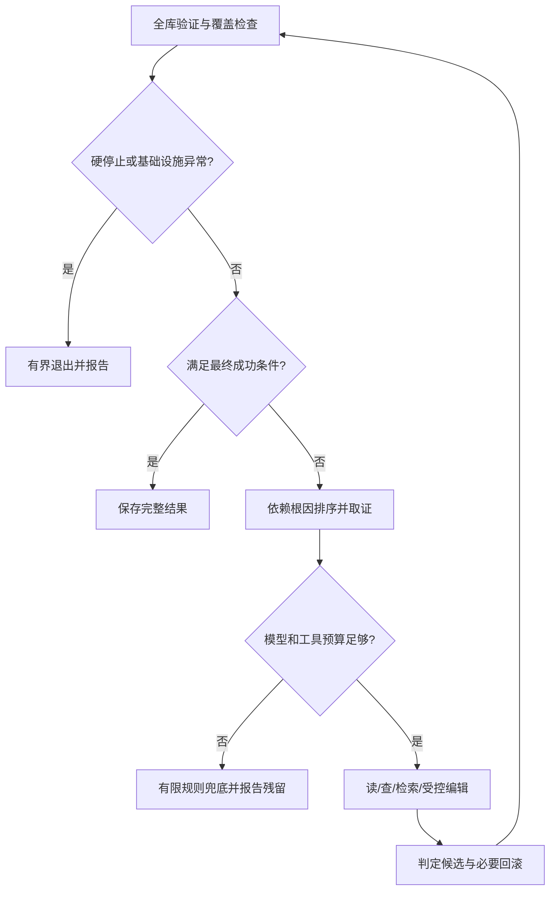

# 单仓编排：实现路标

[全项目执行顺序](../../LANDMARKS.md) · [全项目问题总账](../../DEFECTS.md) · [上级文档](../LANDMARKS.md) · [本级问题](../orchestrator/DEFECTS.md)

更新：2026-10-17。以当前代码为现状；下文未勾选项均为待修复/待开发。**按根目录 S00→S25 执行，到本目录时再展开；本级编号不重新从 1 开始。**

## 文件落点

待新增 `state.py/tools.py/success_policy.py/load_sweep.py/prompts.py/graph.py`。先用程序化/fake 模型验证闭环，之后再接真实模型；七个工具注册名可稳定，但底层映射必须真实。

工具映射：read_file→`inline_tools.read.read`；grep_symbol→`inline_tools.grep.grep`；query_index→已有查询及 S03 新增依赖查询；check_scene_consistency→`scene_check`；retrieve_migration_rule→`retrieve_cached(RetrievalQuery(..., target_version=...))`；edit_file→`edit(..., hunks=...)`；check_single_file→`run_verify_tool("check_file", target, ...)`。

工具调用以 RunContext 闭包注入路径、规则、诊断、StateStore。patch 成功登记 `commit`，索引过期先重建；模型看不到 Bash、裸 Git、自由 argv 和真实 DB 选择权。

## 控制流

首版每轮一个候选 patch，之后再允许多个关联 patch。图 state 保存目标诊断、当前 attempt/operation 引用、round_start_sha、候选提交、覆盖、模型层级、必要消息和完整 Gate 状态；全部 attempt 与成本事实以审计账本为准，图内只留摘要/引用，避免无限增长。

`NO_PROGRESS_WARN/FILE_STUCK_WARN` 由宿主触发重读/换策略，再有限升级 L2；`OSCILLATION_ESCALATE/BUDGET_EXCEEDED/CIRCUIT_OPEN` 按约定硬停止。429/5xx 有重试上限，大模型不可用可退小模型，预算不足仅有限 rule-only；规则无适用就报告 PARTIAL。

## 最终成功条件

基础设施健康、无硬停止；脚本检查完整且没有根因/pending pointer；不可信文件已补证；场景全量无未解错误；要求资源均有完成证据；陷阱已解决或有明确结案。弃权/超大/二进制等覆盖不足不静默当完整成功。`shader_checked` 不是渲染正确性的证明。

sweep 只补 V1/V3 未证明部分：固定 --headless --path ... --script ...，**不加 --check-only**，脚本主动 quit。保存资源清单、逐项开始/完成与整次 DONE；超时/崩溃留下未检查集合。临时脚本无论成败清理，且不覆盖用户同名文件。load 不等于 instantiate/运行/渲染；如需行为断言由 eval 提供。

## 调用链与结果一起验收

所有节点与工具通过 RunContext 的 OTel tracer 关联 run/round/attempt/call，失败、拒绝、回滚和缓存命中同样可见；不在各工具初始化一套 provider。报告链接 Langfuse/Phoenix trace，并保留本地证据与导出状态；平台暂时不可用不改变成功判据。S18 的端到端测试同时检查业务结果和调用树，见 [观测契约](../trace/LANDMARKS.md)。

## 原生 checkpoint 与外部恢复的职责

**统一选择**：当前是单机、每仓串行的 StateGraph，不自行实现图调度恢复。S18 使用 `langgraph-checkpoint-sqlite` 的 `SqliteSaver`，编译时注入 checkpointer，执行用 `durability="sync"`；S19 补 Git/业务账本对账和故障注入。内存 saver 只用于不测重启的单测。以后改成多机共享执行，再另立 ADR 评估 PostgreSQL 等后端。

### 谁恢复什么

- **原生 checkpointer**：图状态、已持久化的节点结果与待执行节点；`thread_id=run_id`，新实验新 ID，恢复沿用原 ID。`checkpoint_id` 是某份快照的 ID，不等于 run_id；正常恢复读取最新快照，不任意回放历史。
- **Git 与业务 SQLite**：补丁和回滚是否已发生、验证回执、模型请求/预算/成本及审计事件；不能替框架维护一份 last_node。副作用阶段 PREPARED 等只描述外部操作，不决定图路由。
- **批处理父进程**：任务重排、工作区互斥、Godot 子进程及槽位回收；checkpoint 不会自动清理进程或重启 worker。
- **OTel**：执行追踪。恢复可新建 trace，但 run_id/thread_id 不变；追踪后端不作为状态恢复来源。

图持久化对象使用可版本化的数据结构，包含目标/提案、当前操作 ID、诊断覆盖、模型层级、必要消息，以及完整 ProjectVerifyState（含 previous_view/source_snapshot）。节点入口从该快照构造当前 run 的 Gate StateStore，节点结束将更新值返回图状态；重入时同一验证回执只合并一次。连接、模型客户端、锁、路径绑定配置和 tracer 在新进程的 RunContext 中重建，不放入 checkpoint。预算以业务账本重新核对，不能把图中的旧摘要当作可花额度。

### 新运行与恢复入口

新运行：准备独立状态目录并创建 run_id/thread_id → 完成 L0/B0 → 编译带 checkpointer 的图 → 提交一次初始输入。每 run 的 `checkpoints.sqlite` 与 `audit.sqlite` 分开；框架管理 checkpoint 表，宿主管审计表，即使均为 SQLite 也不构成与 Git 的跨库原子事务。

恢复：先持生命周期锁、回收该任务已登记残留进程并核对版本/源码/索引/副作用回执；再用原 checkpointer 与 thread_id 读取 `graph.get_state(config)`。有待执行节点时，使用 `graph.invoke(None, config, durability="sync")`，不重新提交初始输入；已完成且没有待处理任务时直接返回报告，异常/待中断任务须检查 tasks，不能只看 next 是否为空。若未来引入 `interrupt()`，其人工答案用 `Command(resume=...)`，不混作故障恢复 API。

L0 在修复图外：若崩溃发生在首份图 checkpoint 前，按 L0 的阶段记录处理，已完成的转换/冻结不重做；无法证明阶段完成时停止并报告，不凭空构造一份“已完成”快照。已建立 checkpoint 却丢失/损坏时明确拒绝，不悄悄从头启动。

### 为什么还需要对账：一个具体窗口

`prepare_patch → apply_patch → verify → decide` 拆成可持久化节点；prepare 先固定 operation_id 和预期旧 SHA。假设 apply 已提交 C，但返回值未保存时被 kill，恢复可能再次进入 apply。它必须先按 operation_id 核验账本、Git 中登记的事务标记及文件指纹：已证明是 C 就补齐/返回旧回执，不再应用 diff；未执行才执行；未知脏树则停止。回滚也使用独立操作 ID，不能裸跑 Git。

模型调用、验证和报表输出同样拆成可重入节点；一个节点若含多个副作用，分别封装原生 `@task` 并保留稳定调用顺序。完成且已持久化的结果可复用，但 task 已启动未完成仍可能再跑，包装 task 不等于外部副作用恰好一次。模型服务已执行而响应未落盘时，使用其支持的幂等/查询能力；无法确认则保留 UNKNOWN 与预算预留，按策略停止或有限重试，并记录可能的额外费用。

checkpoint 保存不意味着外部代码回退：正常恢复用最新快照；历史 replay/time travel 不开放到现有工作区。调试旧快照先新建隔离项目并核对源码、基线和外部账本，不在已前进的工作树上直接重放编辑。

### 验收顺序

- [ ] S18：假模型提案已持久化后换新进程继续，确认目标/提案/待执行节点及 Gate 历史可恢复；不同 run 不串状态。
- [ ] S19：在改文件后、commit 后、验证后、下一 checkpoint 写入前中断；检查同一 operation 不重复受控副作用，审计事件不重复。
- [ ] S19：未知脏树、图/schema/引擎指纹改变、checkpoint 损坏/丢失均明确拒绝；完成状态不重跑，未知模型费用不归零。
- [ ] S24/S25：kill worker 后由父进程清理并重排，新 worker 打开原文件并持同一 thread 锁恢复；残留进程/信号量另测，不能用图单测代替。

来源：[官方 checkpointer 与 durability 说明](https://docs.langchain.com/oss/python/langgraph/checkpointers)、[官方 task 重入与幂等约束](https://docs.langchain.com/oss/python/langgraph/functional-api)。版本及真实重启/kill 行为仍需按以上阶段验收；当前只有规划，尚无 graph 或 checkpointer 实现。

## 本目录执行清单

### S14：实现宿主、SQLite 账本与 OTel 双后端接线

- [ ] 完成 [S14](../../LANDMARKS.md) 的本范围任务。

**先决条件**：根队列中本步之前的验收门已通过；新增/缺陷测试先写，再改实现。

**做什么**：只实现七个工具适配器；使用宿主 RunContext 和 trace/budget，不在 tools.py 复制数据库或预算器。

**交付物**：交付 programmatic/fake 模型可调用的工具集合。

**验收**：七个工具独立调用、字段映射、路径隔离、提交登记及错误返回。

**问题详情与复现**：[ORC-01 · 宿主若照旧签名封装，工具无法完成一次调用](../orchestrator/DEFECTS.md)。

### S17：实现补充资源扫描与完整成功条件

- [ ] 完成 [S17](../../LANDMARKS.md) 的本范围任务。

**先决条件**：根队列中本步之前的验收门已通过；新增/缺陷测试先写，再改实现。

**做什么**：先复用 V1 哨兵与 V3，再补资源/不可信文件验证；动态脚本不带 check-only。独立 success_policy 综合各维覆盖。

**交付物**：交付 load_sweep、完整资源清单、每项哨兵/超时日志与成功谓词；没有运行证据就标不完整。

**验收**：先用 S01 好/坏/缺证据矩阵；然后真实引擎验证孤立坏资源、干净对照、崩溃续查。

**问题详情与复现**：[ORC-03 · 动态资源扫描带 check-only，循环不会执行](../orchestrator/DEFECTS.md)；[ORC-02 · 根因为空或 CLEAN 不等于验证完整](../orchestrator/DEFECTS.md)。

### S18：接通单仓编排、原生 checkpoint 与有界路由

- [ ] 完成 [S18](../../LANDMARKS.md) 的本范围任务。

**先决条件**：根队列中本步之前的验收门已通过；新增/缺陷测试先写，再改实现。

**做什么**：先 rule-only/fake 跑闭环，再接 L1/L2；编译图时接原生 SqliteSaver，固定 thread_id=run_id、durability="sync"，将图状态与运行时句柄分离。所有分支关联 OTel；外部副作用崩溃窗口在 S19 验收。

**交付物**：交付 graph/state/prompts、checkpoint 工厂及单仓报告；图执行位置/提案/消息/完整 Gate 状态由 checkpoint 恢复，业务 SQLite 只保留审计、成本和副作用回执。

**验收**：假模型闭环、有限重试/循环/预算出口；用全新进程重开同一 checkpoint 恢复提案和待执行节点；验证缓存/失败 span、持久化序列化和 run 隔离。不将此步等同于完整 kill 恢复验收。

**问题详情与复现**：[ORC-04 · 新增诊断就回滚，会把真正进展当作恶化](../orchestrator/DEFECTS.md)；[ORC-05 · 图状态恢复未指定原生 checkpointer，容易与审计账本重复实现](../orchestrator/DEFECTS.md)。

### S19：实现 checkpoint 恢复与外部副作用对账

- [ ] 完成 [S19](../../LANDMARKS.md) 的本范围任务。

**先决条件**：根队列中本步之前的验收门已通过；新增/缺陷测试先写，再改实现。

**做什么**：持久化图状态只由原生 checkpointer 管理。对账器先核验外部状态，再读取原 thread_id 的最新 checkpoint；按下面 checkpoint-contract 恢复，节点重入通过回执返回已有结果。

**交付物**：交付 checkpoint 续跑与失败节点重入测试；不从审计 rounds 猜测下一节点，不重新发送初始输入覆盖状态。

**验收**：完整 Gate 状态与预算不重置；已完成 run 直接返回报告，已完成 L0/冻结/补丁不重做，未知状态拒绝。

## 完成一项怎么记

在相关 DEFECTS 条目附测试名称/命令、实际结果与版本；只勾本步验收通过的项目。涉及代码的目录同步 README。L3 草稿放本地 DESIGN_NOTES；跨模块有后果的决定落 docs/adr。文档修订完成不等于业务修复完成。
