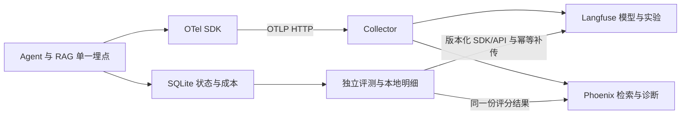

# 轨迹、预算与恢复：实现路标

[全项目执行顺序](../../LANDMARKS.md) · [全项目问题总账](../../DEFECTS.md) · [上级文档](../LANDMARKS.md) · [本级问题](DEFECTS.md)

更新：2026-10-17。以当前代码为现状；下文未勾选项均为待修复/待开发。**按根目录 S00→S25 执行，到本目录时再展开；本级编号不重新从 1 开始。**

## 先实现能用的账本，再做恢复和缓存

待新增 `store.py/report.py/budget.py`；S18 加 `checkpoint_factory.py`，S19 再加外部副作用对账 `resume.py`，S20 再加 `fix_cache.py`。SQLite 使用 schema_version、WAL、外键、短事务、busy_timeout；数据库默认在 Agent 项目外。启动时检查 schema 不兼容，不静默新建覆盖。

最小逻辑表：

- runs：run_id 主键，repo_id、来源提交、工作区、状态、版本/配置指纹、开始/结束和失败分类。
- rounds：(run_id, round_idx) 唯一，开始/最终提交、Gate 状态引用与覆盖。
- patch_attempts：attempt_id、工具调用 ID、候选 patch/commit、ACCEPTED/REJECTED/ROLLED_BACK、守卫原因。
- events：event_id、run/round/attempt/call 关联、时间、工具/模型/检索/验证类型、结构化结果及原始日志引用。
- model_calls：模型与定价版本、输入/输出/缓存 token、预算预留/实耗/未知费用；无 patch 的失败也入账。

每 run 与每次评测条件独立；resume 复用原 run_id，新实验生成新 run_id。不要用 repo_id 作运行主键，不把一轮多个补丁塞入一个 SHA 字段。

## 恢复协议

图状态与执行位置交给 LangGraph 原生 checkpointer；本目录只提供 saver 工厂、审计/预算与外部操作对账，不复制图调度器。每 run 使用独立 checkpoints.sqlite 和 audit.sqlite，thread_id=run_id，恢复保持不变。完整 Gate 状态进入 checkpoint，运行句柄重建、预算从账本核对。

副作用用稳定 operation_id 和 PREPARED→PATCH_COMMITTED→VERIFIED→RECORDED 回执，保存前后 SHA/文件指纹。恢复持锁先对账，再交由框架续跑；已证明操作完成就返回旧回执，未知脏树拒绝。框架 checkpoint、审计 SQLite 与 Git 不是同一事务，不能承诺所有模型调用恰好一次；结果不明的费用记 UNKNOWN 并保留预算。详见 [原生恢复契约](../orchestrator/LANDMARKS.md#checkpoint-contract)。

## 共享缓存和报告

fix-cache 放单独共享库。key 含源/目标版本、模型/提示/工具契约、规则/语料指纹和必要 receiver/上下文；命中只获得候选，仍经 edit/verify。RAG 库缓存与 LLM 修复缓存是两种不同缓存，报告分开。

单仓报告含 run_id、来源/B0/最终提交、parse_clean、coverage_complete、semantic_review、残余根因/场景/陷阱/未检查文件、所有保留及回滚 attempt、成本和日志引用。初始错误为 0 时 error_reduction 写 N/A；观测失败、成本未知不能伪造零值。模型 token 节省若无对照，只能标估算。

## OTel、Langfuse 与 Phoenix：按这个契约实现

**要解决的问题**：例如“检索缓存命中→模型重试→补丁拒绝→引擎超时”是一条运行历史。需要能从最终失败找到每个调用、规则和补丁，也要能比较不同配置的实验。SQLite 保存完整事实；OTel 负责把执行过程关联起来并送到观测后端。

### 1. 文件、依赖和数据出口（S14）

待新增 `telemetry.py`、RAG observer 适配及 `collector.example.yaml`；部署说明留在本目录 README，架构决策追加 ADR。Python 根运行依赖声明 OTel API/SDK/OTLP HTTP exporter；需要的 OpenInference 属性约定锁定版本。后端评测客户端在根 eval 依赖组管理，核心迁移无需同时依赖两套后端 SDK。

应用只向一个 Collector 发 trace，由不同 exporter/pipeline 输出到两端。Collector 配置包含资源属性、必要过滤/属性转换、batch、发送队列和有界重试。两个后端按各自 schema 做映射；**不能假定任意 gen_ai 属性无需转换就能在两端正确展示**。只初始化一个 provider，不同时叠加原生 SDK 和框架 hook 造成重复模型 span。

Langfuse 接收 OTLP HTTP，信号路径为 `/api/public/otel/v1/traces`，不要配置 gRPC。按部署版本设置认证和 ingestion header；例如当前 v4 文档要求 `x-langfuse-ingestion-version: 4`，实际实现时锁定服务/SDK 版本再测。Phoenix endpoint 按部署填入 OTLP traces 地址，本地示例为 `http://localhost:6006/v1/traces`。全部密钥由环境注入，不写 YAML 明文。

### 2. 调用树和关联字段（S01 定义，S13/S14 接线）

树结构：`run → L0/round → triage/retrieve/model/edit/verify/sweep/judge`。检索下拆 embedding、BM25/vector、融合/重排；验证下拆 V1/V2/V3。记录工具拒绝、回滚、无进展、超时和异常原因，不能只给成功调用埋点。**缓存命中保留 retrieve span，标 cache.hit，并且没有实际发生的模型/embedding 调用不生成计费 span。**

所有相关 span 都带 run_id、repo_id 哈希、round_idx、attempt_id/call_id（适用时）、目标版本、规则/语料/模型/提示/配置指纹及语义约定版本。run_id 是业务主键；OTel trace_id 是 128 位标识、span_id 是 64 位标识，三者不能混用。SQLite 事件保存映射，报告提供后端查询链接。两端需要按调用过滤的属性随子 span 传播，不能只放根 span。

Langfuse 主要查看模型输入输出摘要、usage/成本、提示版本和实验评分；Phoenix 使用 OpenInference 兼容属性查看检索候选、排序、引用规则、工具与失败位置。后端显示成本可辅助诊断，**预算以本地逐调用预留/结算为准**；价格版本和未知 usage 必须保留。

### 3. 独立评分接入（S21–S23）

OTLP 只承载调用链；数据集、实验、评分和人工标注使用后端 SDK/API 显式创建。新增 eval 适配器把本地统一的 experiment_run_id、case/item_id、evaluator_version、score/reason、配置指纹及 trace/span 映射到两端平台 ID。一份程序/Judge/人工评分复用到两端，默认关闭重复的后台 Judge。

先落本地逐项明细，再写 export_outbox 补传；幂等键包含 backend、experiment_run_id、item_id、metric、evaluator_version。平台不支持客户端幂等时，使用持久化映射与查询确认，处理“已接收但响应丢失”，不能盲目重复创建。隐藏真值由隔离评测器读取，默认不上传正文；实验输入只含对 Agent 可见的内容。

指标分别命名：parse_clean、coverage_complete、行为断言、Judge 风险、检索 GT 覆盖率/Recall@K 与 MRR@K、token/成本/耗时。不能把字节匹配当唯一正确解，也不能把 Judge SAFE 当语义证明。每个汇总保留分子、分母、来源和版本，平台结果必须能回到本地明细复算。

### 4. 失败、恢复与跨进程（S14/S19/S24/S25）

业务事务先写 SQLite，OTel 后台有界导出；断网不能让模型费用消失，不能无限卡住 worker。明确记录 export pending/failed/dropped；本地关键账本写失败走独立错误出口。用于正式评测的 trace 全采样；生产可配置采样，但统计仍读取完整账本。后端不可用时可保留本地运行结果，相关观测/平台验收标不完整。

进程池任务显式 inject/extract W3C traceparent/tracestate；worker 启动后新建 provider/exporter 和各类数据库句柄，不继承活跃线程/锁。线程与异步任务传播也要实测。正常退出有界 force_flush/shutdown；kill 后丢失的未导出 span 不伪造为完成。恢复保持 run_id，新建 trace 并用 Span Link 指向已持久化的旧 trace/span；SQLite 的中断事件解释链路缺口。

原始 Godot 日志保存在本地，以 trace/run 引用；大段源码只按白名单截取并脱敏，答案、凭据和完整路径不默认上传。延迟/调用/导出失败等 OTel metrics 使用低基数维度，run_id/仓库路径不能作指标标签。Langfuse/Phoenix 按 trace/评测后端验收；metrics/logs 若需远程导出须另配支持对应信号的后端，首版可本地导出，不能宣称这两端自动收齐所有信号。

### 5. 最小验收顺序

- [ ] S01：定义 fake 调用树、评分结构与真值隔离对照，不连外部服务。
- [ ] S13/S14：内存 exporter 验证父子关系、属性、缓存、拒绝、超时和去重；本地假 OTLP 服务验证队列、协议和断网。
- [ ] S14/S18：真实 Langfuse/Phoenix 各查到同一 fake/单仓调用链，模型调用数和本地账本一致；覆盖失败分支。
- [ ] S19：commit 后中断恢复，新旧 trace 由相同 run_id 和 Span Link 关联，不丢费用、不重改文件。
- [ ] S21–S23：本地明细与两端实验逐项对齐；重复/断网补传不重复评分；不同评测器版本不覆盖旧结论。
- [ ] S24/S25：spawn 子进程传播正确，正常退出可 flush；kill/后端失效仍有限退出，未送达有明确记录。

接口依据：[OTel Collector](https://opentelemetry.io/docs/collector/architecture/)、[Python 上下文传播](https://opentelemetry.io/docs/languages/python/propagation/)、[Langfuse OTel 接入](https://langfuse.com/integrations/native/opentelemetry)、[Langfuse 外部评分](https://langfuse.com/docs/evaluation/evaluation-methods/scores-via-sdk)、[Phoenix 观测与评测](https://arize.com/docs/phoenix)。这些说明核对于 2026-10-17，实施时固定版本并做真实端到端验收。

## 本目录执行清单

### S01：先建最小独立评测器与观测契约测试

- [ ] 完成 [S01](../../LANDMARKS.md#s01) 的本范围任务。

**先决条件**：根队列中本步之前的验收门已通过；新增/缺陷测试先写，再改实现。

**做什么**：先定义固定 case、隐藏真值、结果分类与独立验证器；同时写 OTel span/评分字段契约和内存 exporter 反例。六类项目先用 fake verifier，再补锁定引擎集成验证。

**交付物**：交付正确/错误/等价替代对照，隐藏答案位于 Agent 工作区外。定义 case_id→run_id→trace/span 的关联及评分明细格式，OTel 正式接线在 S14。

**验收**：错误不通过、缺证据标 INVALID/INCOMPLETE；read/grep 不读真值；fake 调用树与评分重复提交测试先固定预期。

### S13：修检索配置、符号提取和 OTel 观测事件

- [ ] 完成 [S13](../../LANDMARKS.md#s13) 的本范围任务。

**先决条件**：根队列中本步之前的验收门已通过；新增/缺陷测试先写，再改实现。

**做什么**：拒绝未知键，使用 fusion.rrf_k/channels，补真实报错句式。统一 observer 的开始/结束/缓存字段，为 S14 的 OTel 适配保留 request/call_id；候选参数留 S21 独立复验。

**交付物**：交付命中/未命中均可关联的检索事件；只记录必要候选 ID、版本、排序与耗时，不将真值送进检索输入。

**验收**：两次调用、一次缓存命中可观测；observer 异常不改变检索结果；宿主与库不重复记账；规则/语料可打开。

### S14：实现宿主、SQLite 账本与 OTel 双后端接线

- [ ] 完成 [S14](../../LANDMARKS.md#s14) 的本范围任务。

**先决条件**：根队列中本步之前的验收门已通过；新增/缺陷测试先写，再改实现。

**做什么**：先做 SQLite run/round/attempt/event 和预算，再同步落地单一 OTel 埋点、Collector 与 Langfuse/Phoenix；执行下面 otel-contract。恢复与共享缓存留后续步骤。

**交付物**：交付 store/budget/telemetry、版本化属性映射和双后端示例配置；工具及 RAG observer 共用 RunContext 中的 tracer。

**验收**：多 run/attempt/失败费用；缓存与失败调用树、重复埋点、假 OTLP 断网；真实两端可按相同 trace_id 查询一次 fake 运行。

**问题详情与复现**：[TRC-01 · 按 repo_id 保存一行，无法区分试验和多个补丁](DEFECTS.md#trc-01)；[TRC-04 · 只给成功轮次记成本，预算与可观测性不完整](DEFECTS.md#trc-04)；[TRC-05 · 缺少统一调用链，检索、补丁与引擎失败无法关联](DEFECTS.md#trc-05)。

### S18：接通单仓编排、原生 checkpoint 与有界路由

- [ ] 完成 [S18](../../LANDMARKS.md#s18) 的本范围任务。

**先决条件**：根队列中本步之前的验收门已通过；新增/缺陷测试先写，再改实现。

**做什么**：提供原生 SqliteSaver 工厂和 run/thread 映射，checkpoint 文件与审计库分开；worker 内创建连接，编排 compile 时注入。

**交付物**：交付 checkpoint_factory 与 schema/版本元数据；不自定义 checkpointer 存储协议，不改框架内部表。

**验收**：新进程重开后状态可读取；异 run 隔离、句柄不序列化、durability="sync" 行为在选定版本下有契约测试。

### S19：实现 checkpoint 恢复与外部副作用对账

- [ ] 完成 [S19](../../LANDMARKS.md#s19) 的本范围任务。

**先决条件**：根队列中本步之前的验收门已通过；新增/缺陷测试先写，再改实现。

**做什么**：先持工作区锁，校验图/状态 schema、引擎和配置指纹，再对账 Git/业务 SQLite/索引；使用同一 thread_id 读取最新 checkpoint 并恢复待执行节点。以稳定 operation_id 识别已完成副作用，恢复创建关联的新 OTel trace。

**交付物**：交付 resume 对账器，不自建第二套图调度器；checkpoint 管图状态，Git/SQLite 管代码回执与完整账本。已完成 L0/冻结不重做；模型请求结果不明时保留未知费用，不宣称所有外部调用恰好一次。

**验收**：apply/commit/verify/下一 checkpoint 写入前四类中断；回执已存而图结果未存时安全返回旧回执，不重复受控补丁；Gate 历史/预算不重置，未知脏树或版本不匹配拒绝；新旧 OTel trace 可关联。

**问题详情与复现**：[TRC-02 · Git、副作用账本与图 checkpoint 之间有崩溃窗口](DEFECTS.md#trc-02)；[TRC-06 · 观测导出与恢复混用会丢账，进程切换还会断链](DEFECTS.md#trc-06)。

### S20：增加共享修复缓存

- [ ] 完成 [S20](../../LANDMARKS.md#s20) 的本范围任务。

**先决条件**：根队列中本步之前的验收门已通过；新增/缺陷测试先写，再改实现。

**做什么**：在最小闭环与恢复可靠后，才优化跨仓复用；共享缓存库独立于每仓 trace，记录候选来源和失效原因。

**交付物**：交付带版本/上下文指纹的缓存；命中仍走守卫/验证；跨仓命中率与实际节省调用可重算。

**验收**：不同版本/owner 不碰撞；坏候选不重复应用；并发写不丢记录。

**问题详情与复现**：[TRC-03 · 每仓本地缓存不能跨仓复用，短 key 又可能复用错修复](DEFECTS.md#trc-03)。

### S21：扩展变异、复验 RAG 并接入平台实验

- [ ] 完成 [S21](../../LANDMARKS.md#s21) 的本范围任务。

**先决条件**：根队列中本步之前的验收门已通过；新增/缺陷测试先写，再改实现。

**做什么**：逐例验证健康原版、变异生效和 L0 后残留；独立复验 RAG。新增 Langfuse/Phoenix 的 dataset/experiment/score 适配，评分先本地落盘再幂等推送。

**交付物**：交付可复现样本与逐项结果、两后端对象映射和 outbox。每个 case 关联 run/trace、规则/配置/评测器指纹；同一评分复用，两端不重复跑模型。

**验收**：等价解/行为/字节分开；fresh/reused 和调参/测试隔离；上传断网/重复/响应丢失不重复逻辑评分，两端汇总可由本地明细复算。

### S23：完成平台对比实验、baseline 与消融报告

- [ ] 完成 [S23](../../LANDMARKS.md#s23) 的本范围任务。

**先决条件**：根队列中本步之前的验收门已通过；新增/缺陷测试先写，再改实现。

**做什么**：实现事件到单仓/批处理报告的导出与指标重算，不负责启动 baseline 模型。

**交付物**：交付 JSON/Markdown 报告，保留覆盖与费用未知状态。

**验收**：零初始错误削减率 N/A，回滚补丁不算保留修复，失败费用不丢失。

### S24：实现进程池批处理、上下文传播与限流

- [ ] 完成 [S24](../../LANDMARKS.md#s24) 的本范围任务。

**先决条件**：根队列中本步之前的验收门已通过；新增/缺陷测试先写，再改实现。

**做什么**：每 worker 启动后新建模型/SQLite/Lance 和 OTel provider/exporter；任务信封注入/提取 W3C traceparent/tracestate。所有 converter/V1/V2/V3/sweep 经同一 Godot 槽位边界。 每 run 独立 checkpoint 文件，worker 重开 SqliteSaver；同一 thread_id 不允许并发恢复。

**交付物**：交付 batch CLI、独立运行目录、跨进程关联和正常吞吐数据；正常退出有界 flush/shutdown，不继承活跃导出线程。

**验收**：1/2/4 worker 结果一致、同名不冲突、进程峰值受限；子进程 span 关联正确且不重复埋点，后端故障不打满 worker；单仓失败不抹掉其余结果。

### S25：验收崩溃恢复、观测降级并完成清理

- [ ] 完成 [S25](../../LANDMARKS.md#s25) 的本范围任务。

**先决条件**：根队列中本步之前的验收门已通过；新增/缺陷测试先写，再改实现。

**做什么**：父进程监督并回收残留进程/槽位，按 S19 对账重排；标记中断 trace，以新 trace 关联恢复。清理旧占位、README/ARCHITECTURE/NEXT_STEP 与失效链接。 重新调度保留原 run_id/thread_id，调用同一 resume 入口，不重建初始图输入。

**交付物**：交付 kill/断网/后端不可用测试、恢复及评分补传说明；清单对应真实证据。后端持久化/保留策略按选定部署说明，不承诺超出本地账本的可靠性。

**验收**：无进程/槽位泄漏，任务不丢、受控补丁不重复，未知模型结果单列；导出有界，评分重试不重复；本地与后端差异可解释；真实引擎/后端验收与模拟测试分别报告。

## 完成一项怎么记

在相关 DEFECTS 条目附测试名称/命令、实际结果与版本；只勾本步验收通过的项目。涉及代码的目录同步 README。L3 草稿放本地 DESIGN_NOTES；跨模块有后果的决定落 docs/adr。文档修订完成不等于业务修复完成。
